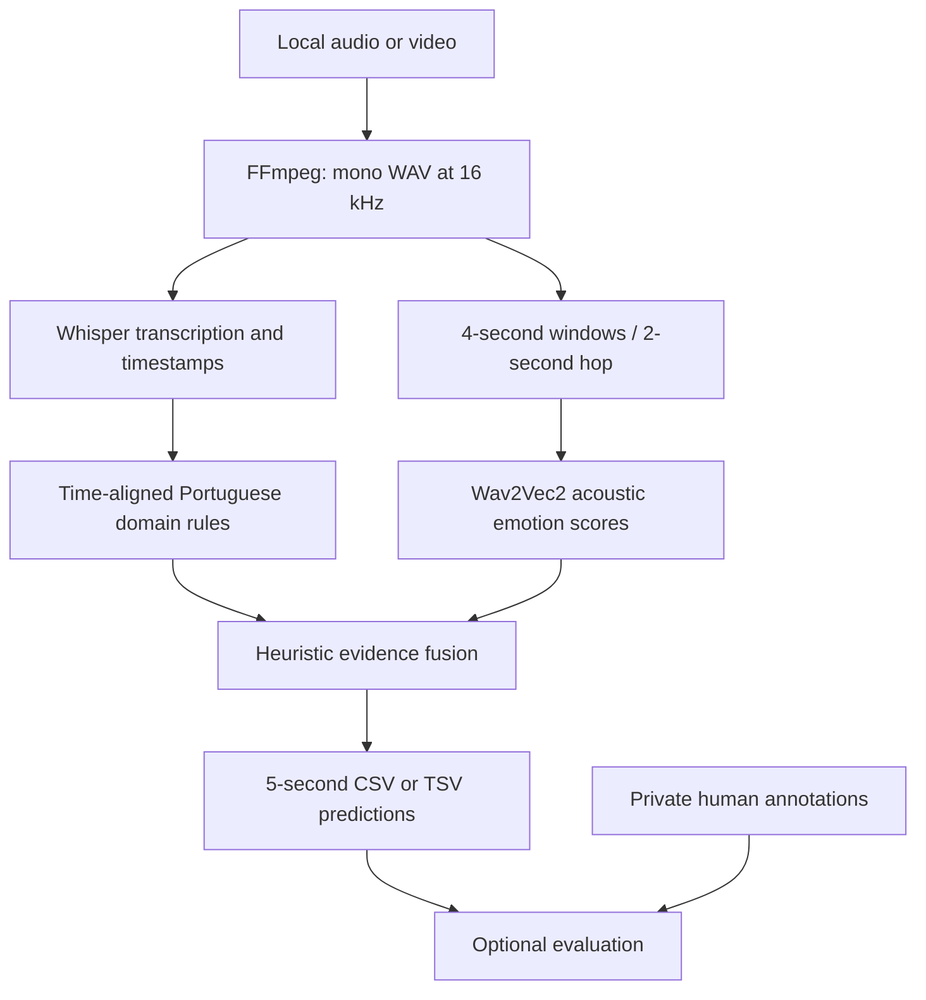

# Coach Emotion Analysis

[](https://github.com/pedrobelota/coach-emotion-analysis/actions/workflows/ci.yml)

A research pipeline that turns local audio or video into a time-indexed table of
emotion hypotheses. It combines **Whisper transcription**, **Wav2Vec2 acoustic
classification**, and **Portuguese football-domain rules** developed in a PIBIC
undergraduate research project.

The engineering pipeline runs end to end. Its pilot classification results are
limited, particularly for minority emotions. These outputs are not reliable
measurements of a person's internal emotional state.

## What it demonstrates

- Integration of pretrained models, word timestamps and domain-specific evidence.
- Sequential model loading, CPU execution and automatic inference fallbacks.
- Auditable aggregation from overlapping windows into five-second intervals.
- Separate analysis and evaluation commands; inference requires no ground truth.
- Unit tests without PyTorch or model downloads, optional integration tests, and CI.
- Honest reporting of imbalance, experimental scope and remaining uncertainty.

This repository integrates existing checkpoints; it does not claim a newly trained
foundation model or a new fine-tuned checkpoint.

## Architecture



Details: [methodology](docs/methodology.md), [model card](MODEL_CARD.md),
[data card](DATA_CARD.md), [migration and validation](docs/validation.md).

## Install

Python **3.11–3.13** is supported. Start with an isolated environment:

```bash
git clone https://github.com/pedrobelota/coach-emotion-analysis.git
cd coach-emotion-analysis
python -m venv .venv
```

Activate with `.venv\Scripts\Activate.ps1` in Windows PowerShell or
`source .venv/bin/activate` in bash. Then:

```bash
python -m pip install -e ".[dev]"
coach-emotion --help
```

This lightweight installation is sufficient for evaluation, unit tests and schema
examples. It does **not** install the neural inference stack.

For audio analysis, install [FFmpeg](https://ffmpeg.org/download.html), verify that
`ffmpeg -version` works, then install PyTorch for your hardware using its
[official selector](https://pytorch.org/get-started/locally/). This release supports
PyTorch 2.6–2.7. Add the inference dependencies:

```bash
python -m pip install -e ".[inference]"
```

CPU-only PyTorch can be installed separately, for example:

```bash
python -m pip install "torch>=2.6,<2.8" --index-url https://download.pytorch.org/whl/cpu
python -m pip install -e ".[inference]"
```

GPU users must match their PyTorch build, driver and the native libraries required by
[CTranslate2/faster-whisper](https://github.com/SYSTRAN/faster-whisper#gpu).
PyTorch reporting CUDA support does not prove that faster-whisper can load its CUDA
libraries. The tested machine used torch 2.7.1+cu118; that local build is not imposed
on other machines. Model downloads happen on first inference and can consume several
GB of disk and RAM. No API key or paid model API is required.

See [reproducibility](docs/reproducibility.md) for tested dependencies and the limits
of reproducing the private pilot experiment.

## Quickstart without models

```bash
coach-emotion evaluate --predictions examples/synthetic_predictions.csv --ground-truth examples/synthetic_ground_truth.tsv
```

These are four invented intervals with deliberate mistakes: exact accuracy is 50%,
and collapsed-neutral accuracy is 75%. They demonstrate the interface only.

## Analyze your own recording

```bash
coach-emotion analyze --input your-recording.wav --output outputs/predictions.tsv --details outputs/details.tsv --device cpu
```

Supported inputs include WAV, MP3, FLAC, OGG, M4A, AAC, MP4, MOV, MKV, AVI, WEBM,
MPEG and MPG. The default configuration uses `large-v3-turbo`; CPU inference can
be slow. For a smaller, non-equivalent demo configuration:

```bash
coach-emotion analyze --input your-recording.wav --output outputs/small-demo.tsv --config configs/cpu-demo.json
```

CLI flags override matching JSON settings. Use `--model`, `--backend`, `--device`,
`--window-ms`, `--hop-ms` and `--interval-seconds` for explicit control. `--device cuda`
requests GPU with fallback; use `cpu` to avoid GPU attempts. Defaults preserve the
research window and fusion settings. Changing models/settings invalidates a direct
comparison with historical pilot metrics.

`--windows outputs/windows.json` exports raw window evidence **including transcript
text**. Treat this output as private. Existing output files and input/output path
collisions are rejected. A failed acoustic window aborts the run rather than being
silently represented as neutral.

The stable output columns are:

| Column | Meaning |
| --- | --- |
| `inicio_s`, `fim_s` | Start and end seconds, relative to the analyzed clip |
| `codigo_emocao` | 0–6 research code, listed below |
| `rotulo_modelo` | Portuguese label corresponding to the code |
| `avaliacao_modelo` | Coarse sentiment grouping (0, 1 or 2), **not** the emotion code |
| `intervalo` | Human-readable time interval |

Codes: **0** neutral without intervention, **1** neutral with intervention,
**2** joy, **3** surprise, **4** anger, **5** sadness, **6** fear.
Intervention is inferred from domain rules, not from speaker diarization. An
unrecognized utterance can therefore receive code 0. This is a known limitation.

When using `--start-seconds` / `--end-seconds`, final times are relative to the
cropped clip. Ground truth must use the same time origin. Input shorter than the
analysis window is rejected. A final tail-aligned window covers a nonaligned ending.

## Evaluate predictions

```bash
coach-emotion evaluate --predictions outputs/predictions.tsv --ground-truth data/annotations.tsv --output outputs/metrics.json
```

Annotation schema and synthetic examples are in [examples/README.md](examples/README.md).
The evaluator distinguishes exact 0–6 accuracy from collapsed-neutral metrics.
It rejects missing overlapping predictions, invalid codes and overlapping final
prediction intervals. The raw-window research evaluator is retained separately in
`coach_emotion.evaluate_audio`; it has a different output contract.

## Historical pilot results

These are **archived research results**, not a new accuracy claim for the migrated
release or for arbitrary audio. The private corpus contains 110 five-second intervals
across 550 seconds; 107 are labeled and three labels are null.

| Metric | Historical value |
| --- | ---: |
| Exact 0–6 accuracy | 51.40% (55/107) |
| Exact accuracy Wilson 95% interval | 42.05%–60.66% |
| Collapsed-neutral accuracy | 73.83% (79/107) |
| Collapsed macro F1 | 0.172 |
| Labeled intervals | 107 |

There are 90 neutral intervals among the 107 labeled intervals. Predicting only
neutral would yield **84.11% collapsed accuracy** on that same slice, exceeding the
pipeline's collapsed accuracy. The macro F1 exposes the weak minority-class results.
Neither accuracy establishes generalization. Adjacent intervals are correlated,
so the Wilson interval is descriptive and does not capture recording-level uncertainty.

See [results](docs/results.md) for class counts and the distinction between historical
research evidence and release smoke testing.

## Tests

```bash
python -m pytest
python -m ruff check .
python -m ruff format --check .
python -m pytest tests/integration
python -m build
```

The default test suite uses synthetic fixtures and stubbed model calls. Integration
tests exercise real FFmpeg and a tiny randomly initialized compatibility model;
they never download pretrained weights. Missing optional dependencies are reported
as skips. The [CI workflow](.github/workflows/ci.yml) runs on Linux and Windows.

For real local models, explicitly run:

```bash
python scripts/smoke_test.py --input your-recording.wav --output-dir outputs/my-smoke --device cpu
```

Add `--offline` only after the selected model files are cached. The runner records
environment, timing, exit code, fallback and output counts in an ignored directory.
It checks execution, not emotion accuracy. `scripts/generate_demo_audio.py` creates
silence for file-handling tests when no authorized recording is available.

## Limitations and responsible use

- The SER checkpoint was fine-tuned on acted **English** speech in RAVDESS. A
  multilingual encoder does not establish Portuguese emotion accuracy.
- Rules and weights are domain-specific heuristics, not learned or calibrated
  probabilities. Softmax confidence is not a reliability guarantee.
- Noise, overlapping speakers, microphone placement and ASR mistakes can change
  predictions. There is no speaker diarization or validated noise rejection.
- Minority classes have extremely small support. The corpus is too small for
  strong generalization claims, and independent held-out recording evaluation is needed.
- Do not use these hypotheses for hiring, discipline, diagnosis or automated
  judgments about identifiable people. Consent and human review remain necessary.

Recordings, private annotations, transcripts, administrative documents, generated
logs and model weights are excluded. Model files are obtained from upstream sources;
their licenses and dataset terms must be checked separately.

No project-wide open-source license is assigned pending confirmation of research
code ownership and institutional requirements. Public visibility is not a grant of
reuse rights. See [publication notes](docs/publication.md).

## Next research steps

Expand annotated recordings, split by recording/speaker before tuning, compare with
simple baselines, audit annotation agreement, and evaluate the contribution of text,
audio and rules independently. Only then consider Portuguese SER adaptation and
packaging a validated service.

## Upstream attribution

- [Whisper](https://github.com/openai/whisper) and
  [large-v3-turbo model card](https://huggingface.co/openai/whisper-large-v3-turbo).
- [faster-whisper](https://github.com/SYSTRAN/faster-whisper) and
  [CTranslate2](https://github.com/OpenNMT/CTranslate2).
- [SER checkpoint/model card](https://huggingface.co/ehcalabres/wav2vec2-lg-xlsr-en-speech-emotion-recognition),
  using a compatibility adapter that preserves the legacy classification head.
- [Transformers](https://github.com/huggingface/transformers),
  [PyTorch](https://pytorch.org/) and [FFmpeg](https://ffmpeg.org/).
